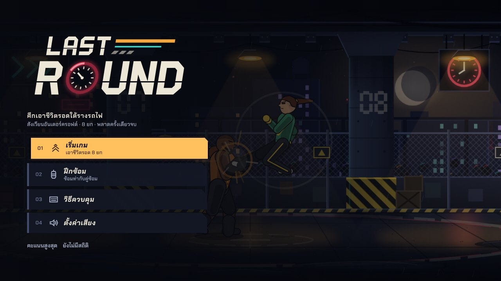
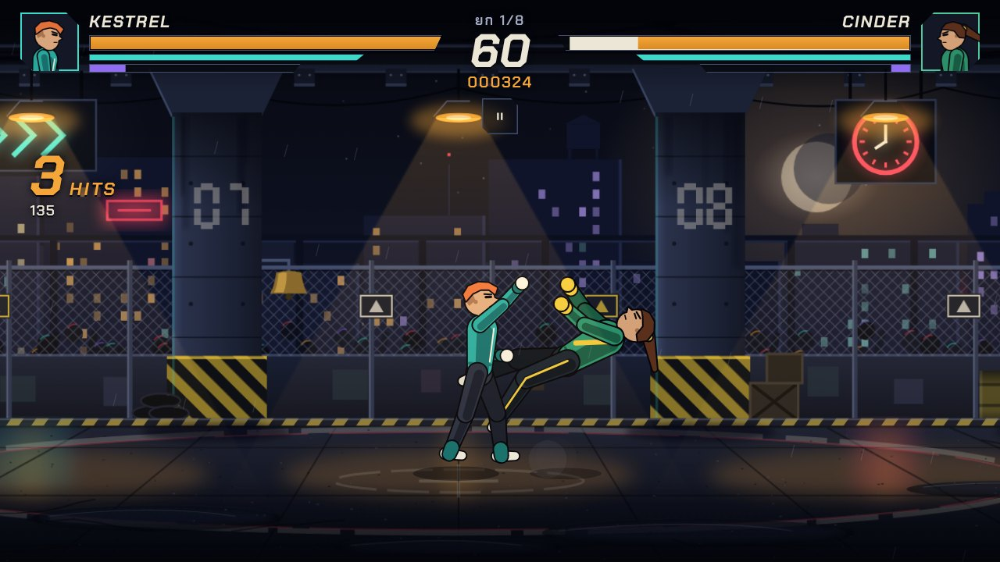
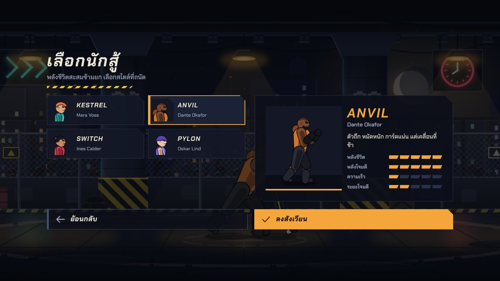
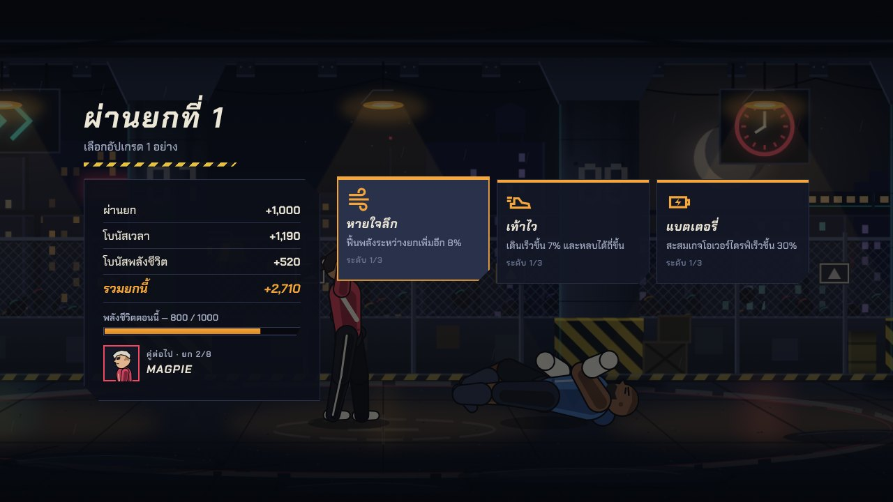
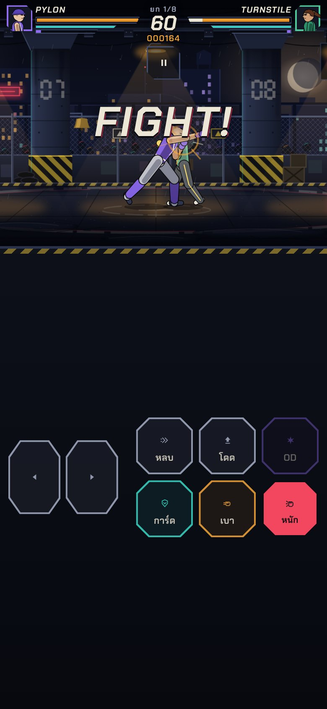

# LAST ROUND

เกมต่อสู้เอาชีวิตรอด 2D มุมมองด้านข้างบนเว็บ — เลือกนักสู้ ฝ่าด่านคู่ต่อสู้ 8 ยกในสังเวียนใต้รางรถไฟยามค่ำ "THE UNDERCROFT"
เล่นได้ทั้งคีย์บอร์ดและจอสัมผัส ภาษาไทย / English

ตัวละคร ฉาก โลโก้ ไอคอน ดนตรี และเสียงเอฟเฟกต์ทั้งหมดเป็นงานต้นฉบับที่สร้างขึ้นในโปรเจกต์นี้
การต่อสู้เป็นเชิงกีฬา: หมัด เตะ ป้องกัน หลบ — ไม่มีอาวุธ ไม่มีเลือด แรงปะทะแสดงด้วยแสงและฝุ่น




| เลือกนักสู้ | เลือกอัปเกรดระหว่างยก | มือถือแนวตั้ง |
| --- | --- | --- |
|  |  |  |

## สารบัญ

- [ฟีเจอร์](#ฟีเจอร์)
- [วิธีควบคุม](#วิธีควบคุม)
- [เริ่มใช้งาน](#เริ่มใช้งาน)
- [การทดสอบ](#การทดสอบ)
- [โหมดออนไลน์ 1 ต่อ 1](#โหมดออนไลน์-1-ต่อ-1)
- [การ deploy](#การ-deploy)
- [โครงสร้างโปรเจกต์](#โครงสร้างโปรเจกต์)
- [งานภาพและเสียง](#งานภาพและเสียง)
- [การเข้าถึง (accessibility)](#การเข้าถึง-accessibility)
- [ข้อจำกัดที่ทราบ](#ข้อจำกัดที่ทราบ)
- [สิทธิ์และเครดิต](#สิทธิ์และเครดิต)

## ฟีเจอร์

- **โหมดเอาชีวิตรอด** — 8 ยก ความยากเพิ่มขึ้นทุกยก ยกสุดท้ายพบ THE CONDUCTOR พลังชีวิตสะสมข้ามยก
  มีแถบพลังชีวิต เกจการ์ด เกจโอเวอร์ไดรฟ์ ตัวจับเวลา คะแนน ตัวนับคอมโบ และหน้าสรุปผล
- **อัปเกรดระหว่างยก** — เลือก 1 จาก 3 (ฟื้นพลัง เพิ่มพลังชีวิต พลังโจมตี ความเร็ว การ์ด ฯลฯ)
- **นักสู้ 4 คน** ที่รูปร่างและค่าความสามารถต่างกัน: KESTREL (เร็ว), ANVIL (หนัก), SWITCH (สมดุล), PYLON (ระยะไกล)
- **ระบบต่อสู้** — เดิน กระโดด ป้องกัน (มี JUST GUARD เมื่อกดพอดีจังหวะ และการ์ดแตกเมื่อป้องกันมากไป)
  หลบแบบมีช่วงอมตะ โจมตีเบา/หนัก คอมโบ `เบา›เบา›เบา`, `เบา›เบา›หนัก` (ท่าปิดฉาก), เตะกลางอากาศ และโอเวอร์ไดรฟ์เมื่อเกจเต็ม
- **โหมดฝึกซ้อม** — คู่ซ้อมปรับได้ (ยืนนิ่ง / ป้องกัน / กระโดด / สู้กลับ) พลังและเกจฟื้นเอง
- **ออนไลน์ 1 ต่อ 1** (ตัวเลือก) — เซิร์ฟเวอร์เป็นผู้ตัดสินผลทั้งหมด ดู[หัวข้อออนไลน์](#โหมดออนไลน์-1-ต่อ-1)
- หน้าจอเริ่มเกม ตั้งค่าเสียง วิธีควบคุม หยุดเกม ชนะ แพ้ และเล่นซ้ำ — จำการตั้งค่าและสถิติสูงสุดไว้ในเครื่อง
- เสียงและดนตรีสังเคราะห์ด้วย Web Audio API ทั้งหมด (ไม่มีไฟล์เสียง) เกมเล่นได้ปกติแม้เบราว์เซอร์เล่นเสียงไม่ได้
- รองรับมือถือแนวตั้ง/แนวนอนและเดสก์ท็อป มี safe area และรองรับ `prefers-reduced-motion`

## วิธีควบคุม

| การกระทำ | คีย์บอร์ด | จอสัมผัส |
| --- | --- | --- |
| เดินซ้าย / ขวา | `A` `D` หรือ `←` `→` | แป้นซ้าย–ขวา (ลากนิ้วสลับได้) |
| กระโดด | `W` / `↑` / `Space` | ปุ่ม "โดด" |
| ป้องกัน (กดค้าง) | `S` / `↓` | ปุ่ม "การ์ด" |
| หลบ | `L` / `C` / `Shift` | ปุ่ม "หลบ" |
| โจมตีเบา | `J` / `Z` | ปุ่ม "เบา" |
| โจมตีหนัก | `K` / `X` | ปุ่ม "หนัก" |
| โอเวอร์ไดรฟ์ (เกจเต็ม) | `I` / `V` หรือ เบา+หนัก พร้อมกัน | ปุ่ม "OD" |
| หยุดเกม | `Esc` / `P` | ปุ่มหยุดใต้นาฬิกา |

ในเมนูใช้ปุ่มลูกศร + `Enter` และ `Esc` เพื่อย้อนกลับ

## เริ่มใช้งาน

ต้องมี Node.js 20 ขึ้นไป

```bash
npm install
npm run dev          # เปิด dev server (Vite) แล้วเข้า URL ที่แสดง
npm run build        # type-check + build ไปที่ dist/
npm run preview      # เปิดดู dist/ ที่ build แล้ว
```

`dist/` เป็นเว็บ static ล้วน ใช้ path แบบ relative จึงวางบน hosting ใดก็ได้ (รวมถึง sub-path เช่น GitHub Pages)

ต้องการไฟล์เดียวสำหรับส่งต่อหรือเปิดตรงจากเครื่อง (ไม่มีโหมดออนไลน์):

```bash
npm run build:single   # ได้ dist-single/last-round.html (~550 KB รวมสคริปต์ ฟอนต์ และภาพทั้งหมด)
```

## การทดสอบ

```bash
npm run typecheck    # TypeScript
npm test             # unit + integration (Vitest): ระบบต่อสู้, AI, โหมดเอาชีวิตรอด, เสียง, เซิร์ฟเวอร์
npm run test:e2e     # build แล้วรัน end-to-end (Playwright) กับ production build
```

ครั้งแรกที่รัน e2e ให้ติดตั้งเบราว์เซอร์: `npx playwright install chromium`
(หรือชี้ไปที่ Chromium ที่มีอยู่ด้วย `PW_CHROMIUM_PATH=/path/to/chrome`)

สิ่งที่ชุดทดสอบครอบคลุม

- **Unit / integration** — ความถูกต้องของ frame data, คอมโบ, การป้องกัน/JUST GUARD/การ์ดแตก, การหลบ, K.O./หมดเวลา,
  ความ deterministic, fuzz ด้วย CPU ปะทะ CPU, สมดุลตัวละคร, กติกาเอาชีวิตรอดและอัปเกรด,
  engine เสียง (รวมกรณีไม่มี Web Audio), protocol และ lobby ของเซิร์ฟเวอร์, การเชื่อมต่อ WebSocket จริง
- **End-to-end** — เริ่มเกม ควบคุมด้วยคีย์บอร์ด โจมตี ป้องกัน จบยก เลือกอัปเกรด แพ้ ชนะ หยุดเกม เล่นซ้ำ ฝึกซ้อม
  การตั้งค่า (คงอยู่หลัง reload) ข้อมูลบันทึกเสีย เสียงใช้ไม่ได้ ปุ่มสัมผัสบนมือถือแนวตั้ง/แนวนอน
  ขนาดปุ่มและการไม่ทับสนาม ชื่อกำกับปุ่ม ความคมชัดข้อความ reduced motion
  ไม่มี console error / asset 404 และโหมดออนไลน์ด้วยเบราว์เซอร์สองตัวกับเซิร์ฟเวอร์จริง

หน้าที่เปิดด้วย `?e2e=1` จะเปิด hook สำหรับทดสอบ (`window.__LR`) — ผู้เล่นทั่วไปไม่เห็น

## โหมดออนไลน์ 1 ต่อ 1

เกมหลักเป็นเว็บ static เล่นคนเดียวได้สมบูรณ์โดยไม่ต้องมีเซิร์ฟเวอร์
**เมนู "ออนไลน์" จะปรากฏก็ต่อเมื่อ build โดยกำหนด `VITE_SERVER_URL`** — ถ้าไม่ได้กำหนด เกมจะไม่แสดงทางเข้าออนไลน์เลย

### เซิร์ฟเวอร์ทำอะไร

- จับคู่อัตโนมัติ หรือสร้างห้องส่วนตัวด้วยรหัส 4 ตัวอักษร แข่งแบบชนะ 2 ใน 3 ยก
- **เซิร์ฟเวอร์เป็นผู้ตัดสิน (authoritative)** — รัน simulation ชุดเดียวกับเกม (`src/sim`) ที่ 60 Hz
  ไคลเอนต์ส่งได้แค่ "ปุ่มที่กดอยู่" เท่านั้น ตำแหน่ง ดาเมจ ผลยก และผู้ชนะมาจากเซิร์ฟเวอร์ทั้งหมด
- ตรวจสอบทุกข้อความจากไคลเอนต์ จำกัดขนาดและอัตราการส่ง จำกัด origin ได้ ผู้เล่นที่หลุดถือว่าแพ้ (forfeit)
- ไคลเอนต์แสดงสถานะการเชื่อมต่อ ค่า ping และแจ้งเมื่อคู่ต่อสู้หรือเซิร์ฟเวอร์หลุด

### รันในเครื่อง

```bash
npm run server:dev                                  # เซิร์ฟเวอร์ที่ ws://localhost:8787
VITE_SERVER_URL=ws://localhost:8787 npm run dev     # เปิดเกมอีกหน้าต่าง
```

ขณะเปิดเกมจาก `localhost` สามารถระบุเซิร์ฟเวอร์ชั่วคราวได้ด้วย `?server=ws://localhost:8787`

### ตัวแปรสภาพแวดล้อม

ไม่มีค่า secret ใด ๆ ในโปรเจกต์นี้ ค่าทั้งหมดเป็นการตั้งค่าทั่วไป

| ตัวแปร | ใช้ที่ | ความหมาย |
| --- | --- | --- |
| `VITE_SERVER_URL` | build ของเว็บ | ที่อยู่ `wss://…` ของเซิร์ฟเวอร์ (เว้นว่าง = ไม่มีโหมดออนไลน์) ดู `.env.example` |
| `PORT` | เซิร์ฟเวอร์ | พอร์ต (ค่าเริ่มต้น 8787) |
| `HOST` | เซิร์ฟเวอร์ | interface ที่ bind (ค่าเริ่มต้น `0.0.0.0`) |
| `ALLOWED_ORIGINS` | เซิร์ฟเวอร์ | origin ของเว็บที่อนุญาต คั่นด้วย `,` เช่น `https://<user>.github.io` (เว้นว่าง = ทุก origin) |
| `MAX_CONNECTIONS` | เซิร์ฟเวอร์ | จำนวนการเชื่อมต่อสูงสุด (ค่าเริ่มต้น 400) |

### นำเซิร์ฟเวอร์ขึ้น production

GitHub Pages รันได้เฉพาะไฟล์ static จึงต้องมี hosting แยกสำหรับ Node ที่รองรับ WebSocket
(เช่น Render, Fly.io, Railway หรือ VPS)

```bash
npm run server:build     # ได้ dist-server/index.js (ไฟล์เดียว ไม่ต้องมี node_modules)
PORT=8787 ALLOWED_ORIGINS=https://<user>.github.io node dist-server/index.js
```

หรือใช้ `Dockerfile` ที่ให้มา: `docker build -t last-round-server . && docker run -p 8787:8787 last-round-server`
ตรวจสุขภาพที่ `GET /health` จากนั้น build เว็บใหม่โดยตั้ง `VITE_SERVER_URL=wss://<โดเมนเซิร์ฟเวอร์>`
(ต้องเป็น `wss://` เมื่อเว็บเสิร์ฟผ่าน HTTPS)

## การ deploy

มี workflow สองไฟล์ใน `.github/workflows/`

- `ci.yml` — ทุก push / pull request: type-check, unit test, build เว็บและเซิร์ฟเวอร์, e2e
- `deploy-pages.yml` — เมื่อ push เข้า `main` (หรือสั่งรันเอง): build แล้วเผยแพร่ `dist/` ไปยัง GitHub Pages

ขั้นตอนที่เจ้าของ repository ต้องทำหนึ่งครั้ง

1. รวม branch งานเข้า `main`
2. **Settings → Pages → Build and deployment → Source: เลือก "GitHub Actions"**
3. (ถ้าต้องการออนไลน์) นำเซิร์ฟเวอร์ขึ้น hosting แล้วตั้ง **Settings → Secrets and variables → Actions → Variables →
   `VITE_SERVER_URL`** เป็นที่อยู่ `wss://…` และตั้ง `ALLOWED_ORIGINS` ของเซิร์ฟเวอร์เป็น origin ของ Pages
4. push เข้า `main` หรือกด Run workflow — URL จะแสดงในหน้า Actions/Environments (`https://<owner>.github.io/<repo>/`)

hosting static อื่น (Netlify, Vercel, Cloudflare Pages ฯลฯ): ใช้คำสั่ง build `npm run build` และโฟลเดอร์เผยแพร่ `dist`

## โครงสร้างโปรเจกต์

```
index.html              โครงหน้าเว็บ
src/
  main.ts               จุดเริ่มต้น โหลดฟอนต์/สไตล์ สร้าง App
  sim/                  simulation ที่ deterministic ไม่แตะ DOM (ใช้ร่วมกับเซิร์ฟเวอร์)
    types.ts data.ts    ชนิดข้อมูล, frame data ของท่า, ค่าตัวละคร
    match.ts boxes.ts   กติกาการต่อสู้ 1 tick, hit/hurt box
    ai.ts rng.ts        คู่ต่อสู้ CPU 10 ระดับ, ตัวสุ่มแบบมี seed
  game/
    app.ts              ตัวควบคุมหลัก: frame loop และการเปลี่ยนหน้าจอ
    survival.ts         กติกาโหมดเอาชีวิตรอด: ลำดับคู่ต่อสู้ อัปเกรด คะแนน
    input.ts            คีย์บอร์ด + ปุ่มสัมผัส → controller mask
    online.ts           ล็อบบี้และการแข่งออนไลน์
    debug.ts            hook สำหรับ e2e (เฉพาะ ?e2e=1)
  render/
    renderer.ts         canvas, กล้อง, การประกอบภาพแต่ละเฟรม
    rig/                ตัวละครแบบ skeleton วาดด้วยเวกเตอร์ + ท่าทางทุกสถานะ
    stage.ts            ฉาก parallax จากเลเยอร์ SVG + แสงโคม รถไฟ ฝนปรอย
    vfx.ts              เอฟเฟกต์แรงปะทะ (แสง ฝุ่น วงคลื่น)
    palette.ts          ชุดสี "Sodium & Neon"
  audio/                engine เสียงสังเคราะห์: ดนตรี 4 เพลง + เสียงเอฟเฟกต์
  ui/                   HUD, หน้าจอเมนู, ข้อความ 2 ภาษา, การตั้งค่า, สไตล์
  net/                  protocol ที่ใช้ร่วมกัน และ WebSocket client
  assets/               SVG ต้นฉบับ: ฉาก 7 เลเยอร์, โลโก้, ไอคอน 33 ชิ้น
server/                 match server (Node + ws): lobby.ts, index.ts
tests/unit/             Vitest
tests/e2e/              Playwright
tools/                  สคริปต์สร้างงานภาพ และหน้า preview สำหรับนักพัฒนา
```

## งานภาพและเสียง

- **ทิศทางภาพ "Sodium & Neon"** — คอนกรีตสีน้ำเงินดำ แสงโคมโซเดียมอุ่น ๆ และนีออนหม่น ๆ ใต้รางรถไฟยกระดับ
  UI ใช้ภาษาป้ายลานรถไฟ: แผ่นตัดมุม แถบเตือนเหลือง-ดำ ตัวอักษรเอียงหนา
- **ตัวละคร** วาดด้วยโค้ดจากโครงกระดูก (ไม่มี sprite sheet) ท่าทางคำนวณจากสถานะใน simulation โดยตรง
  ดูทุกท่าได้ที่ `npm run dev` แล้วเปิด `/tools/rig-preview.html` (เพิ่ม `?boxes=1` เพื่อดู hit box)
- **ฉาก โลโก้ ไอคอน** เป็นไฟล์ SVG ใน `src/assets/` สร้างจากสคริปต์ `tools/gen-stage.mjs` และ `tools/gen-ui-art.mjs`
  (`npm run art` เพื่อสร้างใหม่) ดูฉากได้ที่ `/tools/stage-preview.html`
- **เสียง** สังเคราะห์สด ลองฟังทุกเสียงได้ที่ `/tools/audio-preview.html`
- ฟอนต์ Chakra Petch (รองรับไทย/ละติน) ฝังมากับ build ไม่เรียกเครือข่ายภายนอก

## การเข้าถึง (accessibility)

- ทุกปุ่มมีชื่อกำกับ เมนูใช้คีย์บอร์ดได้ครบ จัดการ focus เมื่อเปลี่ยนหน้าจอ
- เกจต่าง ๆ เป็น `progressbar` พร้อมค่า ข้อความประกาศสำคัญส่งผ่าน live region
- สีข้อความบนพื้นหลังมีคอนทราสต์เกิน 4.5:1
- เคารพ `prefers-reduced-motion` และปรับเองได้ในหน้าตั้งค่า: ปิดการสั่นจอ แฟลช สโลว์โมชัน และแอนิเมชันฉาก
- ปุ่มสัมผัสกว้างอย่างน้อย 44px ในแนวตั้งวางใต้สนามทั้งหมด ไม่บังพื้นที่เล่น

## ข้อจำกัดที่ทราบ

- โหมดออนไลน์ยังไม่มี client-side prediction: การตอบสนองช้าลงตามค่า ping เหมาะกับเซิร์ฟเวอร์ที่อยู่ใกล้ผู้เล่น
  ยังไม่มีการต่อกลับเข้าแมตช์เดิมเมื่อหลุด (หลุด = แพ้) และยังไม่มีระบบบัญชี/อันดับ
- เซิร์ฟเวอร์เก็บสถานะในหน่วยความจำ รันได้ instance เดียว (ยังไม่รองรับการ scale แนวนอน)
- `Dockerfile` ยังไม่ได้ทดสอบ build ในสภาพแวดล้อมที่พัฒนา (ไม่มี Docker daemon) แต่ bundle ของเซิร์ฟเวอร์ทดสอบรันแล้ว
- e2e รันกับ Chromium เท่านั้น ยังไม่ได้ทดสอบบนอุปกรณ์จริงหรือ Safari/Firefox
- ไม่รองรับ gamepad

## สิทธิ์และเครดิต

- โค้ด งานภาพ และเสียงทั้งหมดใน repository นี้สร้างขึ้นใหม่สำหรับโปรเจกต์ ไม่ได้ใช้ทรัพย์สินจากเกมอื่น
- ฟอนต์ [Chakra Petch](https://fonts.google.com/specimen/Chakra+Petch) — SIL Open Font License 1.1 (ผ่าน `@fontsource/chakra-petch`)
- ไลบรารี [`ws`](https://github.com/websockets/ws) — MIT
- ยังไม่ได้กำหนด license ของโปรเจกต์ เจ้าของ repository เป็นผู้เลือก
